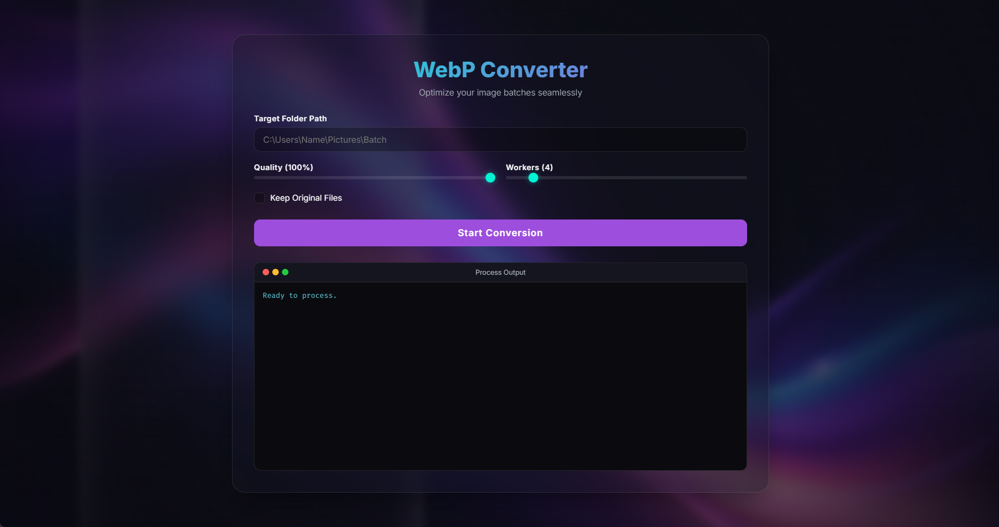

# WebP Image Converter

This Python script automates the process of converting JPG, JPEG, PNG, TIFF, BMP, and GIF images to the WebP format. It's designed to process images in bulk, making it ideal for optimizing large image collections for web use.



## Features

- The optimal application scenario involves converting images generated by Stable Diffusion into the WebP format, primarily to optimize storage efficiency. Additionally, this process includes embedding relevant metadata into the converted images.
- Converts JPG, JPEG, PNG, TIFF, BMP, and GIF images to WebP format (animated GIFs keep their animation via `gif2webp`)
- Lossy (configurable quality) or pixel-exact **lossless** encoding
- **Safe by default**: originals are kept unless you ask for deletion, and are only deleted when encoding *and* metadata copying both succeeded
- Never overwrites: `photo.jpg` + `photo.png` become `photo_jpg.webp` + `photo_png.webp`; an existing `photo.webp` is left untouched
- Preserves metadata from all supported image formats in the converted WebP files (EXIF/XMP/ICC included)
- A1111 / Forge `parameters` are stored in EXIF `UserComment`, readable by A1111's PNG Info tab
- ComfyUI `workflow`/`prompt` are stored the way ComfyUI itself saves WebP (`workflow:` in EXIF Make, `prompt:` in EXIF Model), so you can drag the WebP back into ComfyUI
- Supports recursive directory scanning
- Provides detailed logging for easy troubleshooting
- Utilizes multi-threading for improved performance
- Includes a batch script for easy execution from anywhere on Windows systems
- **Web GUI** with a modern glassmorphic dashboard for browser-based control and real-time progress monitoring
- Command-line interface with extensive options
- Configuration file support for persistent settings
- Progress bar for better user experience
- Dry-run mode to preview conversions (including chosen output names) without making changes
- External tool validation to ensure required tools are available
- Meaningful exit codes (`0` success, `1` some files failed/skipped, `2` fatal error)

## Prerequisites

- Python 3.8 or higher
- Pillow library
- Flask library (for the web interface)
- tqdm library (optional, for progress bars)
- WebP command-line tools (`cwebp`; optionally `gif2webp` for animated GIFs)
- ExifTool

> On Windows, `cwebp.exe` and `exiftool.exe` are bundled in `bin/` and used automatically (see `tool_paths` in `config.json`). On macOS/Linux the bundled `.exe` files are ignored and the tools are taken from your PATH.

## Installation

1. Clone this repository or download the script files:

   ```
   git clone https://github.com/RenX86/WebP-Image-Converter.git
   ```

   or download `WebP-Image-Converter.py`, `run-webp-converter.bat`, and `requirements.txt` directly.

2. Install the required Python libraries:

   ```
   pip install -r requirements.txt
   ```

   Or install individually:

   ```
   pip install Pillow tqdm
   ```

3. Install WebP command-line tools:
   - For Windows: Download from [Google's WebP page](https://developers.google.com/speed/webp/download) and add to your PATH.
   - For macOS: Use Homebrew: `brew install webp`
   - For Linux: Use your distribution's package manager, e.g., `sudo apt-get install webp`

4. Install ExifTool:
   - For Windows: Download from [ExifTool website](https://exiftool.org/) and add to your PATH.
      - In windows rename the 'exiftool(-k).exe' to 'exiftool.exe' after extraction.
      - Add the whole extrated folder to PATH in environment variables.
   - For macOS: Use Homebrew: `brew install exiftool`
   - For Linux: Use your distribution's package manager, e.g., `sudo apt-get install libimage-exiftool-perl`

5. (Optional for Windows users) Add the script directory to your system PATH to run it from anywhere:
   - Right-click on "This PC" or "My Computer" and select "Properties"
   - Click on "Advanced system settings"
   - Click on "Environment Variables"
   - Under "System variables", find and select the "Path" variable, then click "Edit"
   - Click "New" and add the full path to the directory containing your scripts
   - Click "OK" to close all dialogs

## Usage

### Basic Usage

#### On Windows

1. Open a command prompt.
2. Navigate to the script directory or run from anywhere if you've added it to your PATH.
3. Run the batch file:

   ```
   run-webp-converter
   ```

4. Enter the path to the folder containing your images when prompted.
5. No need enter the path in " " format justy directly paste the path and proceed.

#### On macOS and Linux

1. Open a terminal.
2. Navigate to the script directory.
3. Run the Python script directly:

   ```
   python WebP-Image-Converter.py
   ```

4. Enter the path to the folder containing your images when prompted.

### Web GUI

The project includes a browser-based interface powered by Flask for a more visual experience.

1. Install Flask if you haven't already:

   ```
   pip install flask
   ```

2. Start the web server:

   ```
   python app.py
   ```

3. Open your browser and navigate to `http://localhost:5000`

4. Use the dashboard to:
   - Enter or paste a folder path
   - Adjust quality (1–100%) and worker thread count (1–32) with sliders
   - Toggle "Keep Original Files" (on by default; turning it off asks for confirmation) and "Lossless"
   - Click **Start Conversion** and monitor real-time progress with a live log terminal (reloading the page resumes the view)

The server only listens on `127.0.0.1` and rejects requests with a foreign `Host`/`Origin` header. Environment variables: `WEBP_PORT` (default `5000`), `WEBP_HOST`, `WEBP_DEBUG=1` (Flask debug mode; never expose it to a network).

### Advanced Usage

```
python WebP-Image-Converter.py [FOLDER_PATH] [OPTIONS]
```

#### Available Options

- `--quality, -q`: Set WebP quality (0-100, default: 100). Note that even 100 is lossy.
- `--lossless` / `--lossy`: Pixel-exact lossless encoding (quality ignored) / force lossy
- `--keep-originals`: Keep original files after conversion (default)
- `--delete-originals`: Delete originals after a fully successful conversion
- `--overwrite`: Overwrite existing `.webp` files instead of picking a new name
- `--workers, -w`: Number of worker threads (default: CPU count)
- `--dry-run`: Preview what would be converted without making changes
- `--formats`: Specify supported image formats (default: .jpg .jpeg .png .tif .tiff .bmp .gif)
- `--log-file`: Log file path to write logs
- `--verbose, -v`: Enable verbose logging
- `--config`: Configuration file path (default: config.json next to the script)

#### Examples

```bash
# Convert with custom quality
python WebP-Image-Converter.py /path/to/images --quality 85

# Lossless, and delete the originals afterwards
python WebP-Image-Converter.py /path/to/images --lossless --delete-originals

# Use 4 worker threads
python WebP-Image-Converter.py /path/to/images --workers 4

# Preview conversions without making changes
python WebP-Image-Converter.py /path/to/images --dry-run

# Convert only specific formats
python WebP-Image-Converter.py /path/to/images --formats .jpg .png .gif

# Write logs to file
python WebP-Image-Converter.py /path/to/images --log-file conversion.log --verbose
```

## Configuration

### Configuration File

The script supports a `config.json` file for persistent settings. If the file doesn't exist, it will be created with default values:

```json
{
    "webp_quality": 100,
    "delete_originals": false,
    "lossless": false,
    "overwrite": false,
    "supported_formats": [".jpg", ".jpeg", ".png", ".tif", ".tiff", ".bmp", ".gif"],
    "max_workers": 4,
    "tool_paths": {
        "cwebp": "bin/cwebp.exe",
        "exiftool": "bin/exiftool.exe",
        "gif2webp": "gif2webp"
    }
}
```

Relative `tool_paths` are resolved against the script directory; plain names are looked up on PATH.

### Command-Line Override

Command-line options override configuration file settings.

## Logging

The script provides detailed logging information. Use the `--log-file` option to write logs to a file, and `--verbose` for more detailed output. Check the console output for progress updates and any error messages.

## Running the tests

```
pip install -r requirements-dev.txt
python -m pytest
```

Integration tests use the real `cwebp`/`exiftool` and are skipped if those tools are unavailable.

## Contributing

Contributions to improve the script are welcome. Please feel free to submit a Pull Request.

## Acknowledgments

- This script uses the WebP tools developed by Google
- ExifTool by Phil Harvey is used for metadata handling
- tqdm library provides progress bars
- Original Script repo - <https://github.com/TCNOco/TcNo-Random-Scripts.git>
